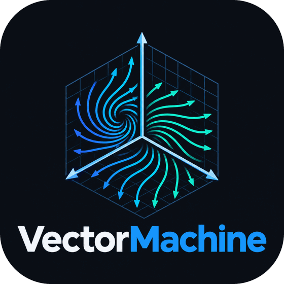

<div align="center">
  <picture>
    <source media="(prefers-color-scheme: dark)" srcset="assets/readme-logo-dark.png">
    
  </picture>
  <p><strong>A Desktop Application for Symbolic Vector Calculus and 3D Field Visualization</strong></p>
  <p>
    <a href="https://github.com/includeduck/VectorMachine/actions/workflows/ci.yml"></a>
  </p>
  <br/>
</div>

## 🌌 Overview

**VectorMachine** is a powerful educational and mathematical tool designed to help students, engineers, and researchers explore vector fields. Built with a sleek, modern PySide6 interface, it seamlessly bridges symbolic mathematics with interactive 3D visualizations.

Whether you're calculating divergence, evaluating curl, or trying to visualize how a field behaves in three-dimensional space, VectorMachine does the heavy lifting for you and shows the intermediate steps along the way.

---

## ✨ Features

- **Symbolic Calculus**: Leverages [SymPy](https://www.sympy.org/) to compute exact partial derivatives for Divergence and Curl SymPy runs in a separate process, so the 10 s timeout and the Cancel button stop a runaway simplification immediately instead of leaving it running in the background.
- **Worked Steps**: Alongside the final answer, VectorMachine shows the formula, every partial derivative, and the unsimplified expression before simplification. (It does not yet name the differentiation rules, such as the product or chain rule, behind each derivative.)
- **Interactive Visualization**: Powered by [PyVista](https://docs.pyvista.org/) and VTK, providing 2D quiver plots and 3D arrow glyphs. The field is evaluated off the GUI thread, and arrows are scaled to the grid so large domains and poles stay readable. On machines without usable OpenGL, a Matplotlib view takes over automatically.
- **Export Anywhere**: Save your work natively to `.json` sessions, or export beautifully formatted `.md` (Markdown), `.txt`, `.pdf`, or `.png` images captured directly from the PyVista render buffer (or from the Matplotlib view when that is in use). PDF exports always use light-theme colours.
- **Keyboard Navigation**: Highly accessible with built-in shortcuts to keep your hands on the keyboard.

---

## 🚀 Quickstart

### Prerequisites
Make sure you have Python 3.12+ installed (the pinned NumPy release requires it).

### Installation
Clone the repository and install the requirements:

```bash
git clone https://github.com/includeduck/VectorMachine.git
cd VectorMachine
python -m venv .venv
# On Windows
.\.venv\Scripts\activate
# On Linux/macOS
source .venv/bin/activate

pip install -r requirements.txt
```

### Running the App
```bash
python src/main.py
```

### Running Tests & Quality Assurance
Install development and test dependencies:
```bash
pip install -r requirements-dev.txt
```

Run the modular test suite with coverage:
```bash
pytest --cov=src --cov-report=term
```

Run code sanity and linting checks:
```bash
ruff check .
```

---

### Entering Fields
- Use `x`, `y` and `z`, with `**` or `^` for powers and implicit multiplication (`2x y` is `2*x*y`).
- Functions: `sin`, `cos`, `tan` and their inverse and hyperbolic forms, `exp`, `sqrt`, `log`/`ln`, `Abs`, `sign`, `floor`, `ceiling`, `atan2`, plus `x!`.
- Constants `pi` and `E`; numbers may use scientific notation (`1e-3`).
- Exact numbers are limited to 1000 digits, so an input like `9**9**9` is rejected rather than freezing the app.

### Theme
- **View → Theme**: Switch between Light, Dark, and System themes (persisted across launches).

## ⌨️ Shortcuts & Controls

- `Ctrl + Return`: Compute Divergence
- `Ctrl + Shift + Return`: Compute Curl
- `Ctrl + Del`: Clear Inputs
- `Ctrl + S`: Save Session
- `Ctrl + O`: Open Session

### 3D Navigation
- **Left Click & Drag**: Rotate camera
- **Right Click & Drag**: Zoom in/out
- **Middle Click & Drag**: Pan camera

### Without OpenGL
Remote desktops, virtual machines and missing graphics drivers often can't provide the OpenGL context that PyVista/VTK needs. VTK often *crashes* rather than reporting an error in that situation, so before creating the 3D view the app checks it safely: Qt's `offscreen`/`minimal` platforms are ruled out at once, and otherwise a throwaway child process renders one small frame. That check starts in the background at launch, so it is normally finished before you open the tab. When the check fails or the 3D view can't start, the Visualization tab says why and switches to a basic Matplotlib view (a 2D quiver, or a 3D quiver in 3D mode) that uses the same settings, theme and PNG export. It redraws more slowly and can't be rotated with the mouse. **Retry 3D view** runs the check again and retries the hardware renderer, for example after a driver update.

---

## 🏗️ Architecture

VectorMachine is designed around three core layers:
1. **Core (`src/core/`)**: headless logic with no Qt imports (a test enforces this).
   - `computation.py`: sandboxed parsing (whitelisted names, a 1000-digit limit on exact numbers), divergence, curl and NumPy field evaluation.
   - `compute_process.py`: the killable SymPy child process.
   - `session.py`: versioned JSON sessions.
   - `export.py`: TXT and Markdown output.
2. **User Interface (`src/ui/`)**: PySide6 components.
   - `app_window.py`: the main window, which builds the layout and menus, owns the dialogs, and wires the parts together.
   - Controllers that hold the logic the window delegates to:
     - `compute_controller.py`: the running computation, stale-result filtering and queued recomputes.
     - `session_controller.py`: saving, and opening with results recomputed.
     - `export_controller.py`: export format dispatch.
     - `theme_manager.py`: the theme menu, persistence and applying palettes.
   - The input, results and visualization panels.
   - `pdf_export.py` (Qt PDF rendering, with a branded report header) and `settings.py` (persisted preferences via `QSettings`).
   - `branding.py` (app name, version, links and icon) and `about_dialog.py` (Help → About).
   - Background workers for computation and field evaluation.
   - `themes.py`, which holds the stylesheets and the WCAG-AA colour palettes.
   - `mpl_fallback.py`, the Matplotlib renderer used when OpenGL is unavailable, and `vtk_probe.py`, the crash-isolated check that decides whether VTK may start.
3. **Documentation (`doc/`)**: internal specs, milestone plans and progress tracking. `bugreport.md` records the bug audit and how each item was resolved, and `Weakness.md` is the architectural critique with its current status.

### Logo and icons
`assets/logo-master.png` is the source logo. Every derived image is generated from it by `tools/build_brand_assets.py`:
- the window and taskbar icon, and `app.ico` for a packaged build, in `src/ui/assets/`;
- the About-dialog and PDF tile;
- the README variants for light and dark themes;
- `assets/social-preview.png`, to upload under the repository's **Settings → Social preview**.

After changing the master, rerun the script:

```bash
python tools/build_brand_assets.py
```

The app version is defined once, in `src/version.py`.

---

<div align="center">
  <sub>Built for exploration. Enjoy the math!</sub>
</div>
